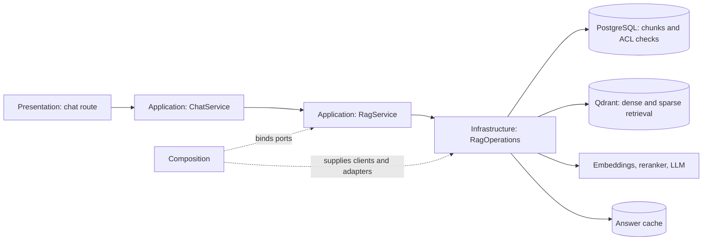

# Обзор архитектуры

## Слои

Backend находится в `server/app/`. Таблица показывает назначение существующих каталогов;
направление зависимостей ниже — целевое ограничение для изменений, а не утверждение,
что весь существующий код уже ему соответствует.

| Слой | Назначение |
|---|---|
| Domain (`domain/`) | Сущности, value objects, правила доступа, редакций и RAG; интерфейсы предметных репозиториев. |
| Application (`application/`) | Сценарии документов, чата, RAG и администрирования; DTO, порты, UoW. |
| Infrastructure (`infrastructure/`) | Адаптеры SQLAlchemy, Qdrant, BM25, Redis, S3, парсеры и ML-клиенты. |
| Presentation (`presentation/`) | HTTP/API, SSE, аутентификация, входная валидация и CLI. |
| Composition (`composition/`) | Контейнер и сборка конкретных реализаций через конструкторы. |

Целевое направление: Presentation → Application → Domain. Infrastructure реализует
порты внутренних слоёв; Composition связывает реализации. Domain не должен зависеть
от FastAPI, SQLAlchemy, Qdrant, `config` или внешних слоёв. Существующий
[main.py](../../server/app/main.py) также выполняет роль composition root API и управляет lifespan.
Сборка сервисов находится в [composition](../../server/app/composition/container.py).

## Границы на пути чата

`RagService` владеет порядком этапов и зависит от прикладных портов из
[`application/rag/ports.py`](../../server/app/application/rag/ports.py). Composition
создаёт инфраструктурный `RagOperations` и передаёт его как реализацию этих портов;
сценарий приложения не собирает Qdrant или ML-клиенты самостоятельно.
`ChatService` собирает `RagContext` из аутентифицированного пользователя, его групп и
назначений куратора. Этот неизменяемый контекст проходит через retrieval и проверку
источников.

Подготовка чата читает пользователя, разговор и историю в UoW, который закрывается до
длительного RAG-вызова. После ответа сообщения и журнал чата сохраняются отдельной
транзакцией. Для документов финальный persistence-шаг атомарно фиксирует редакцию,
чанки и операции vector outbox; обработка индекса выполняется после commit. Это не
держит транзакцию БД открытой во время генерации или обновления внешнего индекса.

Подробные правила и потоки описаны в разделах [ACL](access-control.md) и
[RAG pipeline](rag-pipeline.md).

## Хранилища и интеграции

| Компонент | Роль |
|---|---|
| PostgreSQL | Документы, чанки, пользователи, диалоги, конфигурация, задания и outbox. |
| Qdrant | Хранит векторы и метаданные чанков с ACL; основной RAG-поиск выполняет dense и sparse запросы с общим фильтром доступа. |
| BM25Index | Отдельный локальный snapshot-индекс с ACL-фильтрацией кандидатов до скоринга. Основной `RetrievalPipeline` сейчас обращается за dense и sparse кандидатами к Qdrant. |
| Redis / Arq | Очередь фоновой обработки, кэши и rate limiting. |
| S3-совместимое хранилище (PGSTY Silo в локальном стеке, сервис `minio`) | Исходные файлы документов. |
| OpenRouter | Генерация LLM в зависимости от конфигурации. |
| TEI / DeepInfra | Эмбеддинги и reranking в зависимости от конфигурации. |

OCR и парсинг выполняются инфраструктурными адаптерами; конкретный движок и
включение OCR задаются конфигурацией. Наличие Docker-сервиса не означает его выбор
приложением: `COMPOSE_PROFILES` и сохранённый ML provider имеют разные задачи.

## Загрузка и индексация

HTTP-загрузка проходит через [маршруты документов](../../server/app/presentation/api/routes/documents.py),
[сценарий upload](../../server/app/application/documents/upload.py), сохранение файла в S3
и постановку фонового задания. [DocumentProcessor](../../server/app/application/documents/processor.py)
координирует парсинг/OCR, классификацию, разбиение, подготовку редакций и сохранение.
Чанки, редакции и операции vector outbox фиксируются транзакционно; внешнее обновление
индекса выполняется через инфраструктуру outbox.

CLI `ingest run` читает S3 prefix через ingestion-сценарий.
[DocumentSyncService](../../server/app/application/ingestion/sync.py) сначала создаёт/находит
записи документов, затем сохраняет редакции, чанки и outbox отдельно для каждого документа.
В обоих путях метаданные владельца, видимости и группы должны сохраняться до индексов.

## Ответ на вопрос

[chat.py](../../server/app/presentation/api/routes/chat.py) →
[ChatService](../../server/app/application/chat/service.py) →
[RagService](../../server/app/application/rag/service.py) → реализации стадий в
[infrastructure/ml/rag](../../server/app/infrastructure/ml/rag/rag_steps.py).

ChatService готовит контекст пользователя и историю. RagService упорядочивает подготовку
запроса, проверку безопасности, кэш, retrieval, проверку достаточности свидетельств,
подготовку контекста, генерацию и финализацию источников. Основной поиск сочетает
dense и sparse механизмы согласно настройкам, затем выполняет reranking и отбор контекста.
Есть ограниченный повтор поиска и ранние ответы, поэтому не каждый запрос вызывает LLM.
FastAPI предоставляет SSE `/chat` и синхронный `/chat/sync`; через клиентский nginx
внешние пути имеют префикс `/api`.

Размеры выборки и параметры генерации зависят от применённого снимка конфигурации,
домена и режима запроса. Фиксированные top-25/top-6 не описывают действующие настройки.
Доступность документа в списке и в поиске различается: ADMIN не получает чужие
`CLIENT_PRIVATE` в RAG только из-за роли. См. [термины](../domain/glossary.md) и
[применение конфигурации](../operations/configuration.md).

Стадии поиска, проверки достаточности свидетельств, формирования контекста и выдачи
источников разобраны в [описании RAG pipeline](rag-pipeline.md). Авторитетная модель
доступа и её отображение на Qdrant, точный поиск, BM25 и кэш описаны в
[разделе ACL](access-control.md).
