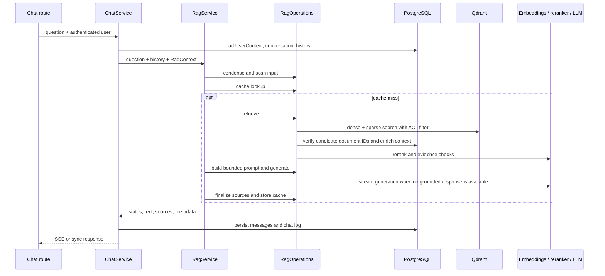

# Конвейер RAG

Здесь описан путь вопроса от HTTP до ответа и источников. Прикладной порядок этапов
задаёт [`RagService`](../../server/app/application/rag/service.py); инфраструктурные
реализации портов собраны в [`RagOperations`](../../server/app/infrastructure/ml/rag/rag_steps.py).
Composition связывает их в
[`create_rag_service()`](../../server/app/composition/service_providers.py).

## Поток запроса

## Этапы

1. **Подготовка запроса.** `ChatService` получает группы и назначения куратора,
   создаёт неизменяемый [`RagContext`](../../server/app/domain/rag/context.py),
   читает историю, а вопрос для журналирования проходит PII-redaction. Перед началом
   RAG его UoW закрыт.
2. **Конденсация и входная безопасность.** `RagOperations` при включённой настройке
   конденсирует вопрос с историей. Сканер проверяет исходный вопрос и историю; при
   блокировке возвращается терминальный ответ без retrieval.
3. **Кэш.** Ключ учитывает query, параметры генерации, дату редакции, версию корпуса и
   область доступа. Cache hit возвращается только после повторной проверки всех
   зависимых документов по основной БД. При невозможности доказать доступ к источникам
   кэш считается промахом.
4. **Построение retrieval work.** Для каждого запроса вычисляются условия ACL, фильтр
   Qdrant, временной фильтр редакций (`effective_from <= date < effective_to` для
   датированных редакций; текущие чанки без дат тоже допускаются), домен вопроса и
   retrieval-параметры. Используется запрошенная дата или текущая. Ширина ответа и
   настройки определяют число кандидатов и rerank-параметры; фиксированное число
   `top-k` не является контрактом.
5. **Поиск кандидатов.** При включённой настройке query decomposition выполняются
   несколько поисковых запросов, результаты сливаются и дедуплицируются. Основной
   hybrid path выполняет dense и sparse запросы Qdrant с тем же ACL/temporal filter,
   затем объединяет ранги weighted RRF. Для legal-профиля поиск сначала ограничивается
   доменом; управляемый профилем fallback расширяет его до корпуса, сохраняя ACL и
   временной фильтр. В некоторых режимах к кандидатам добавляется exact substring
   search, принимающий тот же UserContext и `as_of_date`.
6. **Проверка и reranking.** Кандидаты проходят проверку ID документа по основной БД
   через `is_in_search_scope()`, затем reranker, временное разрешение конфликтов и
   выбор количества документов по ширине вопроса. Если применим legal fallback,
   он повторно ищет и ранжирует в пределах того же access filter.
7. **Обогащение контекста.** Соседние чанки, связанные фрагменты и domain-specific
   scope добавляются через chunk-порты с текущим `UserContext`; обогащённые документы
   повторно проверяются по основной БД. Для historical запросов сохраняется временная
   область. Это защищает от ситуации, когда авторизованный начальный чанк приводит к
   недоступному соседнему документу.
8. **Evidence gate.** Out-of-domain запрос без документов может завершиться до LLM.
   Проверка релевантности и достаточности может выполнить не более одной попытки с
   уточнённым запросом. При недостаточном свидетельстве pipeline может вернуть
   отказной/«не найдено» ответ.
9. **Сборка контекста и генерация.** Выбранные документы форматируются в пределах
   токенного бюджета с учётом истории, ширины и лимитов генерации. Evidence profile
   может вернуть grounded response; иначе ответ генерирует LLM. Результат проверяется
   output scanner и, при включённой настройке, проходит PII-redaction.
10. **Источники и выдача.** Источники извлекаются из выбранных prompt-документов,
    либо из retrieval-документов при пустом выбранном наборе. Опциональный citation
    filter оставляет процитированные документы; для ответа «не найдено» источники
    пусты. Metadata и источники возвращаются в SSE `done` или в sync response и
    сохраняются вместе с сообщением чата.

## Где проходит ACL

ACL относится ко всему пути, а не только к первому запросу в Qdrant:

- Qdrant dense и sparse retrieval требуют общий обязательный ACL-фильтр.
- Exact search и операции с соседними чанками получают `UserContext` через chunk-порт.
- Кандидаты и добавленный контекст повторно сверяются с основной БД по `document_id`.
- Cache key различает scope; cache hit перепроверяет документы-источники.
- Финальный список источников строится только из проверенного контекста.

Подробная матрица ролей, правила списка и поиска и описание адаптеров находятся в
[документе по ACL](access-control.md).

## Dense, sparse и локальный BM25

В текущем `RetrievalPipeline` основной hybrid path вызывает Qdrant dense search и
Qdrant sparse search параллельно, после чего объединяет результаты weighted RRF по
идентичности point. Это не прямой вызов `BM25Index`. Локальный
[`BM25Index`](../../server/app/infrastructure/bm25/bm25_index.py) — отдельный индекс с
snapshot-сериализацией; его `search_with_hashes()` требует условия видимости и
фильтрует документы до скоринга. Если меняется путь локального BM25, нужно сохранить
эту фильтрацию; если меняется основной RAG-поиск — ACL нужен в фильтре обоих Qdrant
поисков и при разрешении кандидатов.

## Рекомендуемые целевые проверки

Для retrieval и потоковой выдачи полезны
[`test_rag_pipeline.py`](../../server/tests/test_rag_pipeline.py),
[`test_rag_service_stream.py`](../../server/tests/test_rag_service_stream.py),
[`test_retrieval_acl.py`](../../server/tests/test_retrieval_acl.py),
[`test_ingestion_acl_consistency.py`](../../server/tests/test_ingestion_acl_consistency.py)
и [`test_answer_cache.py`](../../server/tests/test_answer_cache.py). При изменении
ACL следует также пройти тесты из [документа по ACL](access-control.md#проверки-для-изменений-acl).
